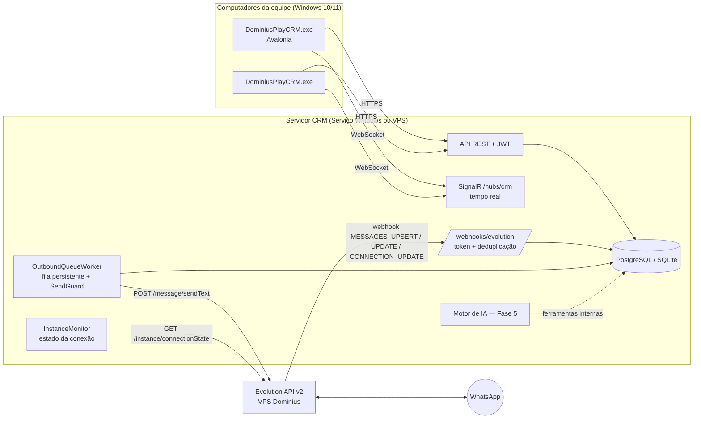

# DOMINIUS PLAY AI CRM — Arquitetura (Fase 1)

## 1. Decisões de stack

| Camada | Escolha | Motivo |
|---|---|---|
| Runtime | **.NET 10 (LTS até nov/2028)** | O .NET 8 sai do suporte em nov/2026; o 10 é a versão LTS atual. |
| App Windows | **Avalonia 11.3** (C#/XAML, MVVM com CommunityToolkit) | Gera `.exe` nativo para Windows 10/11 x64, tema escuro completo, e permite **testes automatizados das telas** (renderização headless) — o WPF não permite isso fora do Windows. |
| Servidor central | **ASP.NET Core 10** (API REST + SignalR + serviços em segundo plano) | Recebe webhooks e processa a fila **sem depender da janela aberta**. Roda como Serviço do Windows ou em Linux/VPS. |
| Banco | **PostgreSQL** (equipe, várias máquinas) ou **SQLite** (uma máquina) — mesmo código via EF Core 10 | Uma única fonte de verdade no servidor. |
| WhatsApp | **Evolution API v2** (sua VPS) | Endpoints conferidos no código-fonte oficial 2.3.x. |
| Credenciais | ASP.NET **Data Protection** (criptografia em repouso) + JWT | A chave da Evolution e da IA ficam só no servidor; o app Windows nunca as recebe. |
| Instalador | **Inno Setup 6** | Instalador `.exe` com atalhos, desinstalador e preservação de dados. |

## 2. Componentes



## 3. Fluxos principais

**Mensagem recebida** → Evolution chama `POST /webhooks/evolution` com header `x-dominius-token` → token validado (comparação em tempo constante) → evento gravado com chave única (`instância:msg:{key.id}`) — repetição é descartada → mensagem gravada com ID real do WhatsApp → se for pedido de descadastro: consentimento revogado, número na lista de bloqueio, card em "Não tem interesse" → dores classificadas → aplicativos avisados via SignalR.

**Mensagem enviada manualmente pelo celular** (`fromMe=true` sem registro no CRM) → conversa passa para **Atendimento humano**, envios automáticos pendentes são cancelados. O eco de mensagens enviadas pelo próprio CRM é reconhecido pelo ID e não dispara isso.

**Envio** → todo envio entra na fila `OutboundQueue` → o worker escolhe por prioridade (humano → respostas → acompanhamentos → abordagens iniciais) → dentro do **bloqueio da conversa**, recarrega o lead e roda o `SendGuard`:
consentimento válido · descadastro · janela de 24h · modelo aprovado fora da janela · campanha ativa e horário/dias permitidos · limite diário · **intervalo mínimo de 5 min entre abordagens iniciais da mesma instância** · contato já feito na campanha · humano atendendo · falhas consecutivas · instância conectada.
Bloqueio definitivo cancela o item; adiamento reagenda. Falha 5xx/429/rede → até 4 tentativas com espera crescente; 4xx → falha definitiva sem repetir. Após reinício do servidor, itens "Enviando" voltam para a fila e são reavaliados.

**Assumir atendimento** → bloqueio da conversa → cancela envios automáticos pendentes → modo "Atendimento humano" + responsável registrado → auditoria. Só o responsável (ou supervisor) devolve para a IA.

**Kanban** → seis colunas fixas. A IA só pode **sugerir** "Negócio fechado"; o atendente precisa confirmar a contratação. Toda mudança gera histórico (`StageChanges`) e auditoria.

## 4. Banco de dados

| Tabela | Conteúdo | Regras |
|---|---|---|
| `Leads` | Dados, qualificação (experiência, painel, clientes, dor principal/secundárias, plano, investimento), etapa do Kanban, modo (IA/humano/pausado/aguardando/encerrado), prioridade, responsável, próxima ação, última interação, resumo, consentimento | Telefone normalizado **único**; token de concorrência |
| `ConsentRecords` | Histórico imutável de autorizações e revogações (origem, evidência, data, quem registrou) | |
| `OptOuts` | Lista de bloqueio / descadastro | Telefone único |
| `Messages` | Histórico (direção, autor: contato/IA/atendente/aparelho/sistema, status de entrega, ID real do WhatsApp, campanha, versão do modelo) | (instância, ID externo) único |
| `OutboundQueue` | Fila persistente (tipo, texto, agendamento, tentativas, erro, chave de idempotência) | Idempotência única |
| `WebhookEvents` | Eventos recebidos (payload, processado, erro) | Chave do evento única → deduplicação |
| `LeadFacts` | Memória comercial: fato + **origem (declarado pelo cliente / inferido pela IA / atendente)** | |
| `StageChanges` | Histórico de movimentação no Kanban | |
| `Plans` | Tabela comercial **versionada**: preço, créditos, limite de logins, benefícios, limites, requisitos, perfil, validade, status de aprovação | (código, versão) único; aprovar arquiva a versão anterior |
| `KnowledgeArticles` | Base de conhecimento com fonte e aprovação | |
| `MessageTemplates` / `MessageTemplateVersions` | Biblioteca de abordagens com versões, aprovação, nome do template no canal oficial e contagem de uso | |
| `Campaigns` | Instância, horário, dias, limite de contatos, intervalo mínimo, limite diário, status | |
| `Users` | Atendente / Supervisor / Administrador, senha PBKDF2-SHA256 | |
| `AuditLogs` | Quem fez o quê e quando | |
| `Settings` | Configurações; segredos criptografados | |
| `ImportBatches` | Resultado de cada importação | |

## 5. Estrutura de pastas

```
DominiusPlay.Crm.slnx
src/
  DominiusPlay.Domain/          Entidades, enums, contratos (DTOs) e regras puras:
                                PhoneNormalizer, SendGuard, CampaignWindow, KanbanRules,
                                PlanRecommender, PainClassifier, OptOutDetector
  DominiusPlay.Infrastructure/  EF Core (CrmDbContext, SeedData), Evolution API (cliente + parser
                                de webhook), importação CSV/XLSX/colar, segurança (SettingsStore, PasswordHasher)
  DominiusPlay.Server/          Program.cs, Endpoints/Api.cs, Hubs/CrmHub.cs,
                                Services/ (InboundProcessor, OutboundQueueProcessor + workers,
                                ConversationService, ConversationLocks, AuthService, EvolutionGateway)
  DominiusPlay.Desktop/         App Windows: Views/ (XAML), ViewModels/, Services/ (ApiClient, Realtime)
tests/DominiusPlay.Tests/       Testes de domínio, infraestrutura, API ponta a ponta e telas (headless)
installer/                      DominiusPlayCRM.iss (Inno Setup) e build.ps1
docs/                           Este documento
```

## 6. Endpoints da Evolution API usados (v2, conferidos no código 2.3.x)

| Uso | Método e rota | Corpo |
|---|---|---|
| Estado da conexão | `GET /instance/connectionState/{instance}` | — |
| Enviar texto | `POST /message/sendText/{instance}` | `{ number, text }` |
| Digitando | `POST /chat/sendPresence/{instance}` | `{ number, presence: "composing", delay }` |
| Verificar números | `POST /chat/whatsappNumbers/{instance}` | `{ numbers: [...] }` |
| Configurar webhook | `POST /webhook/set/{instance}` | `{ webhook: { enabled, url, headers, byEvents, base64, events } }` |
| Consultar webhook | `GET /webhook/find/{instance}` | — |

Autenticação: header `apikey`. Eventos assinados: `MESSAGES_UPSERT`, `MESSAGES_UPDATE`, `SEND_MESSAGE`, `CONNECTION_UPDATE`.
Contatos com endereçamento `@lid` usam `key.remoteJidAlt` para obter o número.

## 7. Inteligência artificial (Fase 5)

- Provedor: **OpenAI** (Chat Completions com chamada de ferramentas). Modelo padrão `gpt-4o`, configurável na tela Configurações (lista os modelos da conta). Modelos GPT-5 não recebem temperatura.
- A chave fica criptografada no servidor (`ai.apikey`), nunca volta ao aplicativo.
- Fluxo: mensagem do cliente → espera configurável (padrão 6 s) para agrupar mensagens seguidas → `AiResponder` monta o contexto (regras, roteiro de qualificação, **somente planos aprovados e ativos**, base de conhecimento aprovada, memória do lead separando fato declarado de inferência, últimas 30 mensagens) → modelo chama ferramentas → resposta entra na fila como `Resposta`.
- Ferramentas internas: `consultar_planos`, `atualizar_qualificacao`, `registrar_fato`, `sugerir_etapa` (não pode marcar Negócio fechado), `atualizar_resumo`, `transferir_para_humano`, `encerrar_conversa`.
- Se um humano assumir ou chegar nova mensagem enquanto o modelo gera a resposta, a resposta é descartada.
- Falha do provedor ou limite diário de tokens atingido → conversa vai para **Atendimento humano** com aviso, nunca fica sem retorno silencioso.
- Simulação (`/api/ai/simulate`) e "Sugerir resposta" para atendentes não enviam nem salvam nada.
